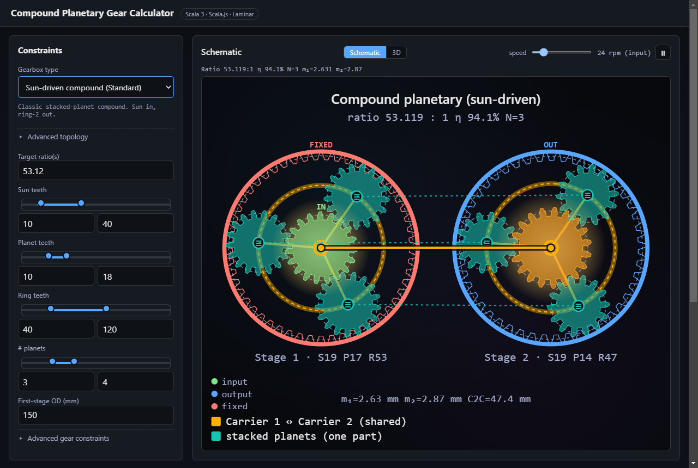
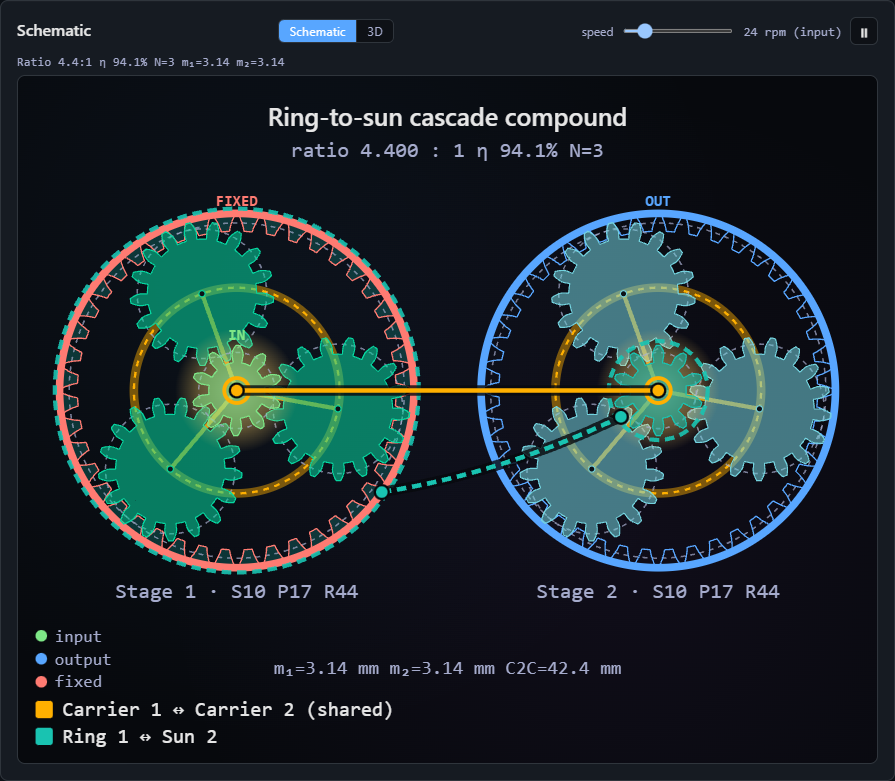
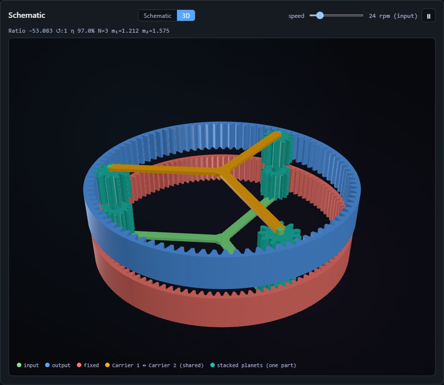
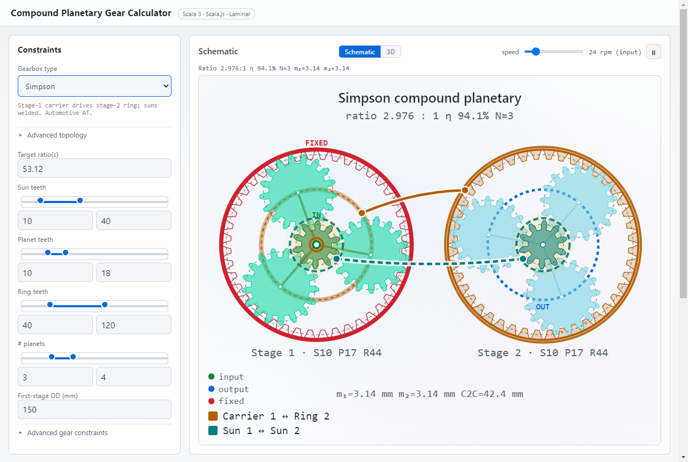
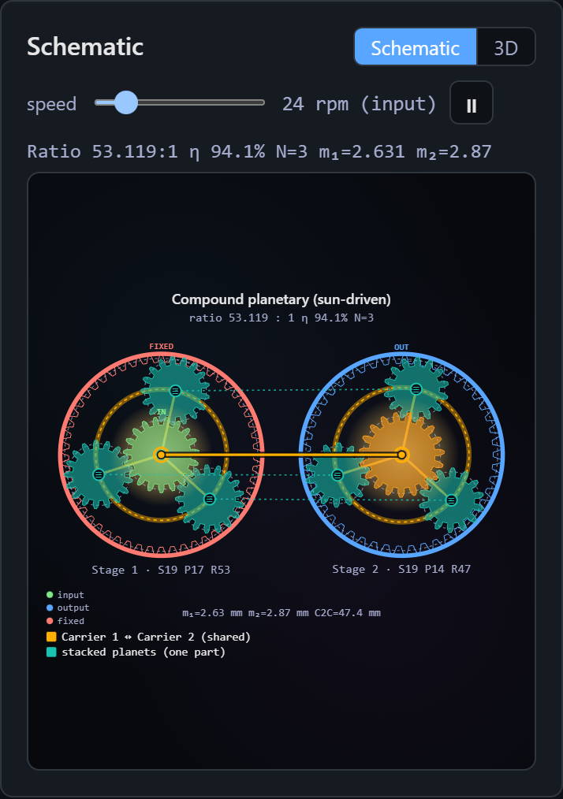
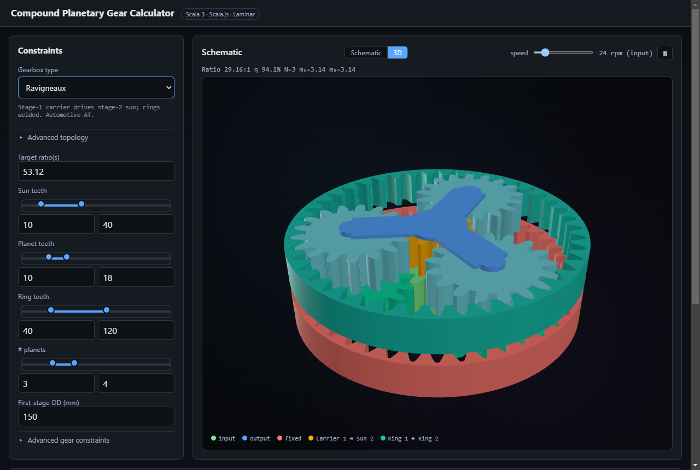

# Compound Planetary Gear Calculator

A Scala 3 toolkit for designing compound planetary gearboxes. Enumerates tooth
combinations under geometric and physical constraints, computes overall ratios,
ranks them against user-supplied targets, and exports CSV / JSON / OpenSCAD.

Three faces, one shared algorithm:

- `cli` — command-line search with a pretty table.
- `web` — Scala.js browser UI with an animated schematic and a 3D view.
- `core` — library; cross-built for JVM and JS.



| | |
|---|---|
|  |  |
| Ring-to-sun cascade: couplings drawn between the stages | Sun-less CDCP in 3D: stacked planets, shared carrier |
|  |  |
| Simpson compound, light theme | Phone layout |



## Layout

```
build.sbt
core/   — pure algorithm, cross-built JVM+JS, zero deps
cli/    — JVM CLI (decline)
web/    — Scala.js + Laminar UI
docs/adr/ — architecture decision records
docs/verification/ — correctness strategy, bug register, assembly conditions
```

## Quickstart

### CLI

```
sbt "cli/run --target 53.12 --max-sun 80 --max-planet 20 --top 10"
```

Useful flags:

- `--mode standard|cdcp|nss|single`; `--sunless 1|2|both` removes a stage's sun gear (`--mode cdcp --sunless both` is a carrier-driven compound with no sun gears)
- `--min-sun / --max-sun`, `--min-planet / --max-planet`, `--min-ring / --max-ring`
- `--min-planets / --max-planets`
- `--target <ratio>` (repeatable)
- `--od <mm>`  first-stage ring outer diameter, `--ring-wall <mm>`, `--planet-clearance <modules>`
- `--sort best|ratio|efficiency|simplicity` ranking (default: closest to the targets, or smallest ratio without targets)
- `--phased-pinions`  stacked planets cut with a planet-specific twist (drops the identical-pinion assembly rule, ADR 0018)
- `--min-module <mm/tooth>`, `--sun-planet-factor <x>` (max planet/sun teeth ratio)
- `--top <k>` results (per target when targets are given)
- `--csv out.csv` / `--json out.json` / `--scad design.scad` (OpenSCAD for the top design), `--no-table`

### Web UI

```
sbt web/webDist       # optimized build (fullLinkJS) -> web/target/dist/{index.html,main.js}
sbt web/webDistDev    # same layout from the fast, unoptimized build (development)
# then serve web/target/dist with any static file server, e.g.
python -m http.server -d web/target/dist
```

`index.html` loads `./main.js`, so the folder is self-contained; use `webDist` for anything you
publish (the optimized build is noticeably faster).

- **Search**: the page drives the same `SearchEngine` as the CLI in ~12 ms chunks, capped at 5 s
  (then "best so far, truncated, narrow your ranges"). Changing the sort re-ranks in place when the
  run finished untruncated and kept every design; otherwise it searches again. Without a target the
  default sort is the lowest ratio, and the pill says so.
- **Topology**: pick a preset (including "CDCP (sun-less)"), or open "Advanced topology" for per-stage
  sun toggles (a pinned sun hands its pin to a free body first; a welded sun, or one with no free body to take over, is locked and the toggle says why), couplings,
  Input/Output/Fixed bodies and "Individually phased pinions" (stacked layouts only: each planet gets
  its own twist, so more designs assemble but the planets are different parts). "Advanced gear
  constraints" has min module, max planet/sun ratio, ring wall (mm) and planet clearance (modules).
- **Targets**: separate several with `;` or a space; a comma between digits is a decimal comma
  (`53,12` = 53.12, `100, 53.12` = two targets). Invalid input shows an inline error, never a hang.
- **URL**: the address bar mirrors the whole state and is read back on load. Parameters: `mode`
  (`standard|single|cdcp|nss|cdcp-sunless`), `coupling1`, `coupling2` (`Coupling` names), `input`,
  `output`, `fixed` (all three, `Body` names), `absent` (e.g. `S1,S2`), `sun`, `planet`, `ring`,
  `planets` (`lo-hi` or a single value), `od`, `minmod`, `ringwall`, `clearance`, `spfact`, `phased=1`,
  `target`, `sort` (`bestfit|ratio|efficiency|simplicity`). Values are percent-encoded.
- Light and dark themes follow `prefers-color-scheme`; the layout is a single column on phones.

### Deploy (Docker)

The page is fully static. The `Dockerfile` builds it with sbt and serves it with Apache httpd on
port 80. CI (`.github/workflows/ci.yml`) runs the tests on every push and pull request. It publishes
the image to `ghcr.io/lhns/compoundplanetarygearcalculator` on pushes to `master` (`sha-<short sha>`)
and on `v*` release tags (the version and `latest`).

```
docker run -d --name cpgc -p 8080:80 ghcr.io/lhns/compoundplanetarygearcalculator:latest
docker build -t cpgc-web .   # local build
```

### Library

```scala
import cpgc.Calculator
import cpgc.constraints.{SearchConfig, Topology}
import cpgc.domain.Ratio

val cfg = SearchConfig(
  topology = Topology.standardCompound,   // or cdcpCompound, nssCompound, sunlessCdcpCompound, ...
  targets  = Seq(Ratio(53.12))
)
val best    = Calculator.best(cfg)                 // top designs per target
val ranked  = Calculator.top(cfg)                  // overall top-K (Scorer.SortBy)
val stream  = Calculator.search(cfg)               // every valid design, lazily
```

`Calculator.engine(cfg)` returns the incremental engine the web UI drives in chunks.

## Testing

```
sbt coreJVM/test coreJS/test web/test
```

The harness (contract, completeness, cross-path, assembly oracle,
independent tabular solver) is described in `docs/verification/correctness-strategy.md`;
known issues are in `docs/verification/bug-register.md`. Diagnostics are excluded by
default (command in that document).

## Architecture

See `docs/adr/` for the design decisions:

1. Language and build — Scala 3 + sbt + cross JVM/JS.
2. Pure functional core — immutable model, `LazyList` enumeration.
3. Domain types — opaque types for `Teeth` / `Module` / `Ratio`.
4. Search strategy — enumerate-then-pair with bounded top-K.
5. Planet overlap formula — chord-based geometry.
6. Efficiency model — coarse per-mesh estimate.
7. CAD export scope — OpenSCAD only.
8. Web architecture — Laminar + SVG schematic.
9. CLI parser — decline.
10. Search termination and compute cap.
11. Alignment and native-rows select.
12. NSS as a design-space expansion.
13. Generalised role assignment.
14. Inverse-solver dispatch (superseded by 17).
15. Topology is the single source of truth.
16. Physical ring OD and planet clearance.
17. One exhaustive search engine with a bounded top-K.
18. Assembly condition for stacked planets.
